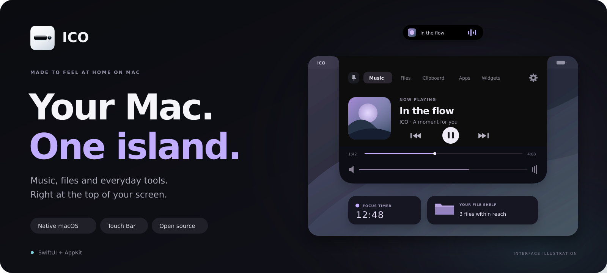

<p align="center">
  <strong>English</strong> &nbsp; / &nbsp; <a href="README_RU.md">Русский</a>
</p>

<p align="center">
  
</p>

<p align="center">
  <strong>A native island for the things you do all day.</strong><br />
  Music, files, clipboard and useful tools — a hover away at the top of your screen.
</p>

<p align="center">
  <a href="https://github.com/infiniunbetatester/ico/releases"></a>
  <a href="Package.swift"></a>
  <a href="https://github.com/infiniunbetatester/ico/releases"></a>
  <a href="LICENSE"></a>
</p>

<p align="center">
  <a href="https://github.com/infiniunbetatester/ico/releases/latest"><strong>Download for macOS ↗</strong></a>
  &nbsp; · &nbsp; <a href="#features">Features</a>
  &nbsp; · &nbsp; <a href="docs/widgets.md">Build a widget</a>
  &nbsp; · &nbsp; <a href="https://github.com/infiniunbetatester/ico/issues">Report an issue</a>
</p>

<br />

## Small when you need space. Open when you need more.

ICO adds a virtual notch to the top of your display. Hover to open it, switch to the panel you need, then get back to work. Pin it open when you want your tools to stay in view.

Built with **SwiftUI and AppKit**, with native **Touch Bar** controls and support for your own **HTML, CSS and JavaScript widgets**.

> **Display compatibility** — ICO is designed for Macs and external displays **without a built-in hardware notch**. It is not intended for Mac displays with a physical camera cutout.

## Features

| Within reach | What you can do |
| :--- | :--- |
| **Music** | See artwork and track details, play or pause, skip tracks and scrub the timeline. Available controls depend on the active player. |
| **File shelf** | Stage files, images and folders, then drag them into another window or workspace. |
| **Clipboard** | Search, copy and delete recent text, links and email addresses. Send a snippet to Telegram in one click. |
| **Screen tools** | Select a screen region to copy its text, scan a QR code, or generate a QR code and export it as PNG. |
| **Audio & focus** | Adjust volume per application and keep a countdown timer in the island. |
| **Apps** | Find running applications and bring the one you need to the front. |
| **Widgets** | Add notes, tasks, weather, world clocks, crypto prices or a pixel ruler from the built-in catalog. Create your own with web technologies. |
| **Touch Bar** | Switch panels, control playback, expand the island or pin it open from supported MacBooks. |

## Install

**macOS 15 or later · Apple Silicon or Intel**

1. Download `ICO.dmg` from the [latest release](https://github.com/infiniunbetatester/ico/releases/latest).
2. Open the image and drag **ICO.app** into **Applications**.
3. Launch ICO and complete the welcome screen.

For text recognition and QR scanning, allow screen recording when macOS asks. The audio mixer uses system audio capture permission; player integrations may also request Automation access.

## Make it yours

Choose a **24 px compact island**, a **6 px strip**, or **hidden mode**. Pin the expanded panel, change whether it stays above other windows, and choose how the Touch Bar behaves.

### Touch Bar

On supported MacBooks, ICO offers two modes: appear while the island is active, or stay visible while you work in other applications. The native Control Strip remains available on the right.

### Widgets

Open **Widgets** to install a built-in widget or create your own. Custom widgets live in `~/.ico/widgets/` and run in a `WKWebView`, with a native `window.ico` bridge for clipboard access, notifications, network requests and more.

**[Widget development guide →](docs/widgets.md)** · [Русская документация](docs/widgets.ru.md)

### Telegram

Send copied text and links from your Mac to a Telegram chat:

1. Create a bot with [@BotFather](https://t.me/BotFather) and start a conversation with your new bot.
2. Open ICO **Settings → Telegram Sync** and enter the bot token and destination chat ID.
3. Test the connection, then use the paper plane button beside a clipboard entry.

## Controls

| Action | How |
| :--- | :--- |
| Open the island | Hover over the compact island or click it |
| Collapse an unpinned panel | Press <kbd>Esc</kbd> or click outside |
| Keep a panel open | Use the pin button in the header or Touch Bar |
| Change appearance and behavior | Open the gear button in the header |
| Stage files | Drag files to the island at the top of the screen |

## Build from source

Use **macOS 15+** and a **Swift 6.0+** toolchain, such as Xcode 16. The local app script builds for your current architecture; the release workflow builds for both Apple Silicon and Intel.

```bash
git clone https://github.com/infiniunbetatester/ico.git
cd ico
chmod +x build_app.sh build_dmg.sh
./build_app.sh
open ICO.app
```

To package the built app as `ICO.dmg`:

```bash
./build_dmg.sh
```

<details>
<summary><strong>Under the hood</strong></summary>

| Component | Technology |
| :--- | :--- |
| Interface & lifecycle | Swift 6, SwiftUI, AppKit |
| Text recognition & QR scanning | ScreenCaptureKit, Vision |
| QR generation | Core Image |
| Per-app audio | Core Audio process taps |
| Widgets | WebKit, HTML, CSS, JavaScript |
| Media integration | MediaRemote adapter and player integrations |
| Persistent Touch Bar presentation | Dynamic DFRFoundation bindings |
| Release builds | Universal `arm64` + `x86_64` DMG via GitHub Actions |

</details>

## Contribute

Found something that could work better? [Open an issue](https://github.com/infiniunbetatester/ico/issues) with your macOS version, Mac model and steps to reproduce it. Pull requests for fixes, widgets and documentation are welcome.

<br />

<p align="center">
  <strong>ICO</strong> &nbsp; · &nbsp; Built for macOS &nbsp; · &nbsp; <a href="LICENSE">MIT license</a>
</p>
