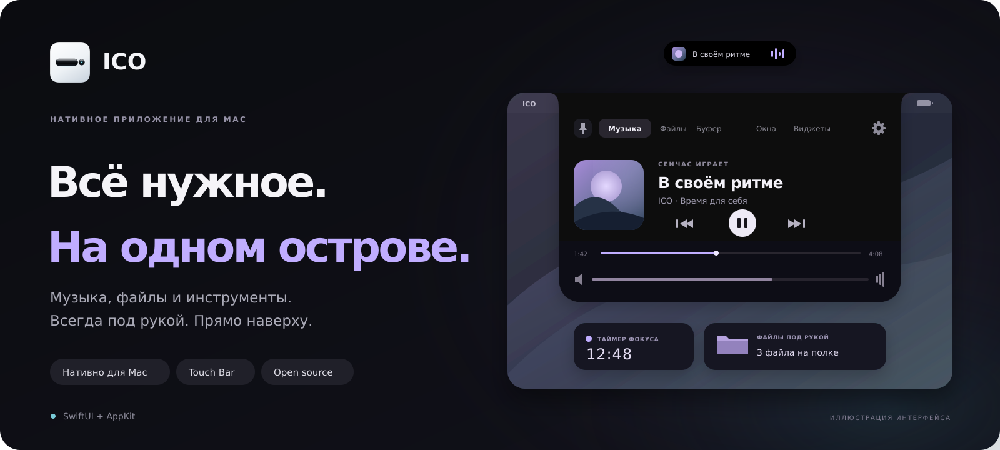

<p align="center">
  <a href="README.md">English</a> &nbsp; / &nbsp; <strong>Русский</strong>
</p>

<p align="center">
  
</p>

<p align="center">
  <strong>Нативный остров для привычных дел.</strong><br />
  Музыка, файлы, буфер обмена и полезные инструменты — у верхнего края экрана.
</p>

<p align="center">
  <a href="https://github.com/infiniunbetatester/ico/releases"></a>
  <a href="Package.swift"></a>
  <a href="https://github.com/infiniunbetatester/ico/releases"></a>
  <a href="LICENSE"></a>
</p>

<p align="center">
  <a href="https://github.com/infiniunbetatester/ico/releases/latest"><strong>Скачать для macOS ↗</strong></a>
  &nbsp; · &nbsp; <a href="#возможности">Возможности</a>
  &nbsp; · &nbsp; <a href="docs/widgets.ru.md">Создать виджет</a>
  &nbsp; · &nbsp; <a href="https://github.com/infiniunbetatester/ico/issues">Сообщить об ошибке</a>
</p>

<br />

## Компактный, пока не понадобится больше.

ICO добавляет виртуальную чёлку к верхнему краю дисплея. Наведите курсор, откройте нужную панель и продолжайте работу. Закрепите остров, если хотите оставить инструменты перед глазами.

В основе — **SwiftUI и AppKit**, нативное управление через **Touch Bar** и поддержка собственных виджетов на **HTML, CSS и JavaScript**.

> **Совместимость с дисплеями** — ICO рассчитан на Mac и внешние мониторы **без аппаратной чёлки**. Приложение не предназначено для дисплеев со встроенным вырезом под камеру.

## Возможности

| Под рукой | Что можно делать |
| :--- | :--- |
| **Музыка** | Смотреть обложку и название трека, управлять воспроизведением, переключать и перематывать. Доступные команды зависят от плеера. |
| **Полка файлов** | Оставлять файлы, изображения и папки на временной полке, затем перетаскивать их в другое окно или рабочее пространство. |
| **Буфер обмена** | Искать, копировать и удалять недавние тексты, ссылки и адреса почты. Отправлять фрагменты в Telegram одним нажатием. |
| **Экранные инструменты** | Копировать текст из выделенной области экрана, сканировать QR-коды и создавать свои с экспортом в PNG. |
| **Звук и фокус** | Регулировать громкость отдельных приложений и следить за таймером прямо в острове. |
| **Приложения** | Находить запущенные приложения и быстро выводить нужное на передний план. |
| **Виджеты** | Добавлять заметки, задачи, погоду, мировое время, курсы криптовалют и экранную линейку из каталога. Создавать свои на веб-технологиях. |
| **Touch Bar** | Переключать вкладки, управлять музыкой, раскрывать и закреплять остров на поддерживаемых MacBook. |

## Установка

**macOS 15 и новее · Apple Silicon или Intel**

1. Скачайте `ICO.dmg` из [последнего релиза](https://github.com/infiniunbetatester/ico/releases/latest).
2. Откройте образ и перетащите **ICO.app** в **Программы**.
3. Запустите ICO и пройдите экран приветствия.

Для распознавания текста и сканирования QR-кодов разрешите запись экрана, когда macOS запросит доступ. Микшер использует разрешение на захват системного аудио; интеграции с плеерами могут запросить доступ в разделе «Автоматизация».

## Настройте под себя

Выберите **компактную чёлку высотой 24 px**, **тонкую полоску 6 px** или **скрытый режим**. Закрепляйте раскрытую панель, меняйте отображение поверх других окон и поведение Touch Bar.

### Touch Bar

На поддерживаемых MacBook доступны два режима: панель появляется при работе с островом или остаётся активной при переключении на другие приложения. Системный Control Strip справа сохраняется.

### Виджеты

Откройте **Виджеты**, чтобы установить готовый вариант или создать свой. Файлы лежат в `~/.ico/widgets/` и запускаются в `WKWebView`. Нативный мост `window.ico` даёт доступ к буферу обмена, уведомлениям, сетевым запросам и другим функциям.

**[Руководство по созданию виджетов →](docs/widgets.ru.md)** · [English documentation](docs/widgets.md)

### Telegram

Отправляйте скопированные тексты и ссылки с Mac в чат Telegram:

1. Создайте бота через [@BotFather](https://t.me/BotFather) и начните диалог с новым ботом.
2. Откройте **Настройки ICO → Синхронизация буфера с Telegram**, введите токен бота и ID чата.
3. Проверьте отправку и нажимайте кнопку с самолётиком рядом с нужной записью в буфере.

## Управление

| Действие | Как |
| :--- | :--- |
| Раскрыть остров | Навести курсор на компактную чёлку или нажать на неё |
| Свернуть незакреплённую панель | Нажать <kbd>Esc</kbd> или кликнуть снаружи |
| Оставить панель открытой | Нажать кнопку закрепления в шапке или на Touch Bar |
| Изменить внешний вид и поведение | Открыть настройки кнопкой с шестерёнкой в шапке |
| Оставить файлы на полке | Перетащить их к острову у верхнего края экрана |

## Сборка из исходников

Понадобятся **macOS 15+** и инструменты **Swift 6.0+**, например Xcode 16. Локальный скрипт собирает приложение под архитектуру текущего Mac; workflow релизов — сразу под Apple Silicon и Intel.

```bash
git clone https://github.com/infiniunbetatester/ico.git
cd ico
chmod +x build_app.sh build_dmg.sh
./build_app.sh
open ICO.app
```

Чтобы упаковать собранное приложение в `ICO.dmg`:

```bash
./build_dmg.sh
```

<details>
<summary><strong>Как устроено внутри</strong></summary>

| Компонент | Технологии |
| :--- | :--- |
| Интерфейс и жизненный цикл | Swift 6, SwiftUI, AppKit |
| Распознавание текста и QR-кодов | ScreenCaptureKit, Vision |
| Генерация QR-кодов | Core Image |
| Громкость отдельных приложений | Core Audio process taps |
| Виджеты | WebKit, HTML, CSS, JavaScript |
| Управление музыкой | MediaRemote-адаптер и интеграции с плеерами |
| Постоянное отображение Touch Bar | Динамические связки DFRFoundation |
| Релизные сборки | Universal DMG: `arm64` + `x86_64` через GitHub Actions |

</details>

## Участие в проекте

Нашли ошибку? [Создайте issue](https://github.com/infiniunbetatester/ico/issues): укажите версию macOS, модель Mac и шаги для воспроизведения. Pull request с исправлениями, виджетами и улучшением документации приветствуются.

<br />

<p align="center">
  <strong>ICO</strong> &nbsp; · &nbsp; Создано для macOS &nbsp; · &nbsp; <a href="LICENSE">Лицензия MIT</a>
</p>
